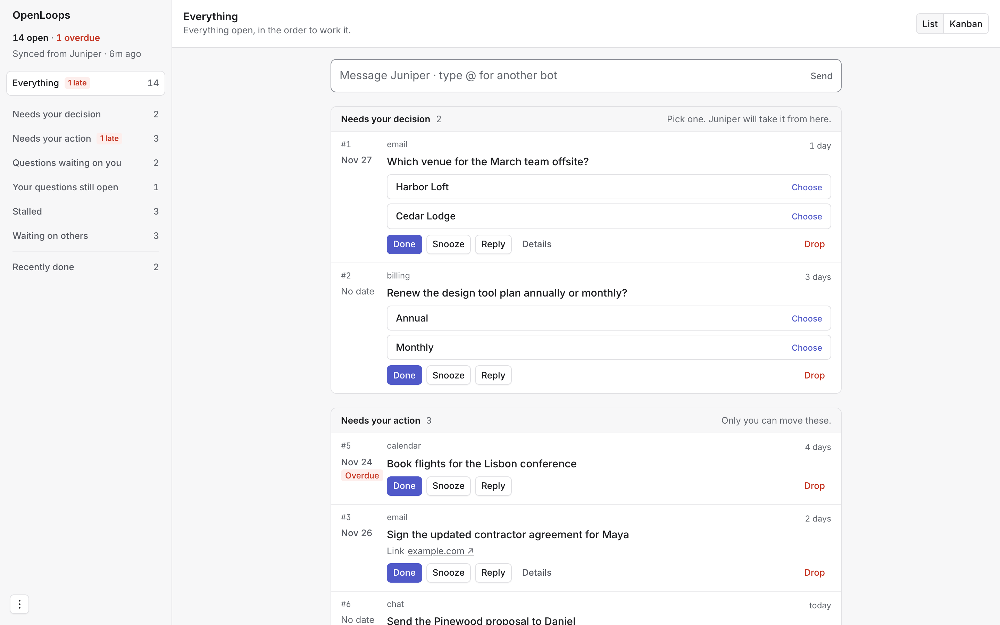
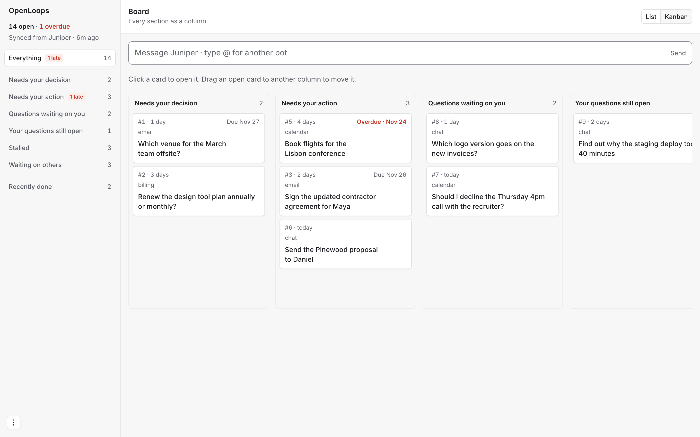
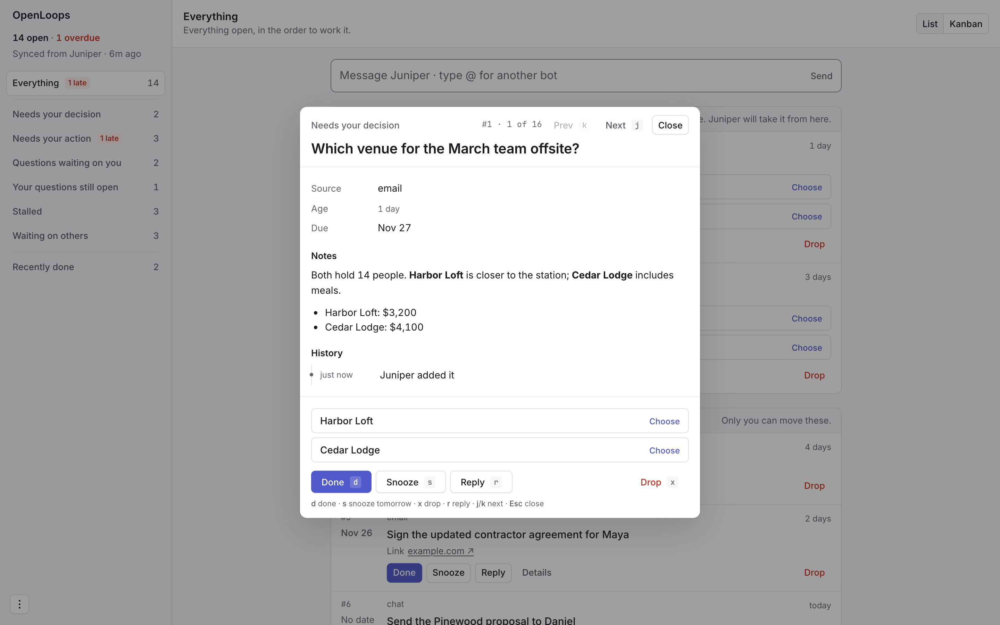
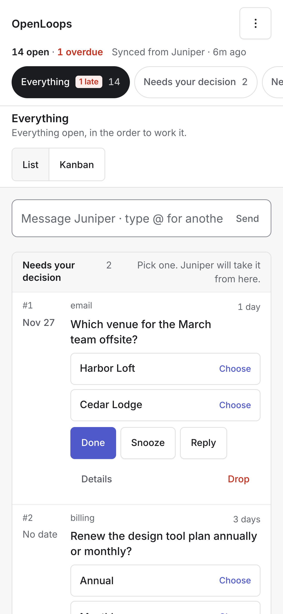

# OpenLoops

A private board for everything your AI assistant needs from you.

Your assistant keeps track of a lot: decisions it can't make alone, emails waiting for your signature, questions it asked you three days ago. OpenLoops puts all of it on one page. You work through it in a few minutes, and the assistant hears about every click right away.



## Why use it

- **One place to look.** No more scrolling back through chat to find what the assistant asked you.
- **Fast to clear.** Pick an option, mark it done, snooze it, or reply, all from the keyboard if you like.
- **Nothing slips.** Cards with no activity for a week move to Stalled so you notice them. Overdue items are flagged.
- **Your assistant stays in the loop.** Every action is sent to it immediately, and queued if it's offline.
- **Refresh asks now.** Refresh tells your assistant to go look for new items, instead of waiting for the next scheduled sync. The board still reloads quietly every minute.
- **Yours.** Self-hosted, one small process with SQLite. It sits behind Cloudflare Access, and it refuses to serve the board until that protection is in place.

## Features

- List and Kanban views, with drag and drop between columns
- Sections for decisions, actions, questions both ways, stalled items, and things waiting on other people
- One-click choices for decisions your assistant has laid out
- Snooze until tomorrow, Friday, next week, or a date
- A message box to send your assistant a quick note, or `@` another bot
- Keyboard shortcuts: `d` done, `s` snooze, `r` reply, `x` drop, `j` / `k` to move
- Works on a phone, with light and dark themes
- Blur mode for when you're sharing your screen

| Kanban | Card | Phone |
| --- | --- | --- |
|  |  |  |

## Get started

Setup is two prompts. You paste each one into an agent and answer its questions.

1. **Install the server.** Give a coding agent with a shell on your server (Claude Code, Codex, or similar) this prompt: [docs/SERVER_SETUP_PROMPT.md](docs/SERVER_SETUP_PROMPT.md). It installs OpenLoops with Docker, puts it behind Cloudflare Tunnel and Access, checks that it works, and hands you the second prompt.
2. **Connect your assistant.** Paste [docs/GROKBOT_SETUP_PROMPT.md](docs/GROKBOT_SETUP_PROMPT.md) into your assistant. It stores the API token, sets up the webhook, and starts syncing your open loops.

If your agent can reach this repository, you can skip the copy and paste:

```text
Install OpenLoops on this server. Follow the instructions in
docs/SERVER_SETUP_PROMPT.md from https://github.com/cmer/openloops
```

You'll need a server with Docker and a domain on Cloudflare.

### Just want to look?

```bash
docker compose up --build -d
docker compose exec openloops node dist/scripts/seed.js
```

Then open <http://localhost:4732>. This loads fictional sample cards and has no protection, so keep it on your own machine.

## Documentation

- [Self-hosting](docs/SELF_HOSTING.md): manual install, environment variables, Cloudflare Tunnel and Access
- [Using the board](docs/USING.md): sections, shortcuts, snooze and stall rules
- [API](docs/API.md): the assistant's side, webhook payloads, every endpoint
- [Development](docs/DEVELOPMENT.md): architecture, running locally, tests

## License

MIT. See [LICENSE](LICENSE).
